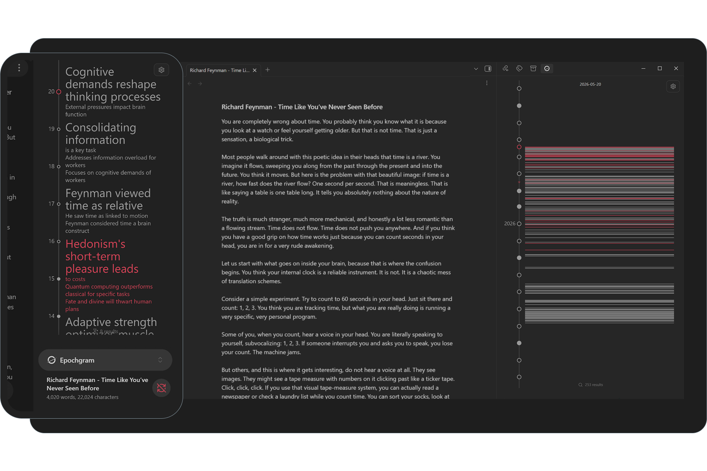
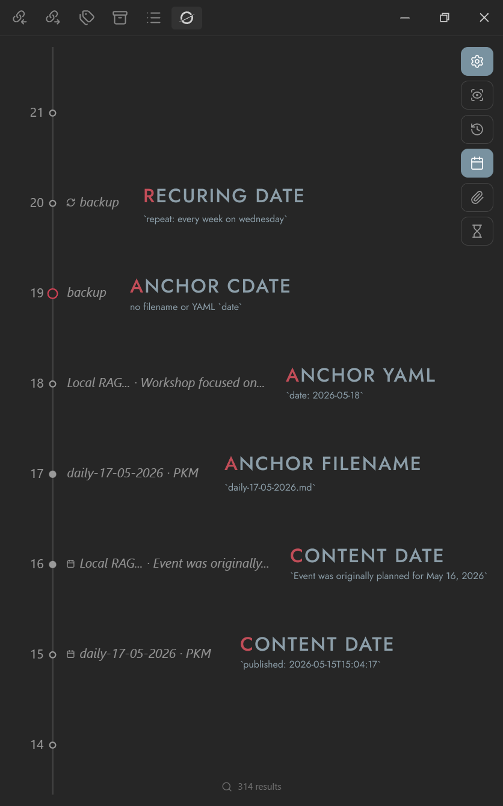

<h1 align="center"></h1>

<h5 align="center">
A Timemap of Your Mind
</h5>

<p align="center">
  <a href="https://github.com/2brn/Epochgram/releases">
    
  </a>
  <a href="https://github.com/2brn/Epochgram/releases">
    
  </a>
</p>

</br>
<p align="center"></p>
</br>

> <font color="#c14d58">Pain</font>. Your vault fills up with quick capture notes. A week later, you've lost the thread. A month later, you can't reconstruct the story — and you don't see the themes, the slow stretches, or the bursts of activity.</br></br>
> <font color="#c14d58">Solution</font>. Epochgram turns your notes into a free interactive timeline. Browse day by day to follow your notes in order, spot bigger patterns across unsorted notes, and edit directly on the timeline — so you can focus on what really matters.</br></br>
> <font color="#c14d58">Epochgram</font> helps you see the bigger picture:
> - Extracted and manual summaries.
> - Find related notes through links, tags, and titles.
> - Color marks and related groups.
> - Calendar sync and recurring events.

## Table of Contents

- [Get Started](#get-started)
- [Cheatsheet](#cheatsheet)
- [Timeline](#timeline)
- [Examples](#examples)
- [Filters](#filters)
- [Search](#search)
- [Actions](#actions)
- [Review State](#review-state)
- [Calendar sync](#calendar-sync)
- [Recurring](#recurring)
- [Similarity](#similarity)
- [Custom YAML](#custom-yaml)
- [Settings & Data](#settings--data)
- [FAQ](#faq)
- [Disclosures](#disclosures)

## Get Started

### Download

Install from **[Obsidian Community plugins](https://community.obsidian.md/plugins/epochgram)**

BRAT

- Install [BRAT](https://community.obsidian.md/plugins/obsidian42-brat) community plugin in Obsidian.
- Use [Obsidian protocol](https://www.epochgram.com/brat) to add Epochgram.
- Or Obsidian Settings → BRAT → Add beta plugin [https://github.com/2brn/Epochgram](https://github.com/2brn/Epochgram).

Manual install

- Download the latest release files from [GitHub releases](https://github.com/2brn/Epochgram/releases).
- Copy `main.js`, `manifest.json`, and `styles.css` into your vault plugin folder: `.obsidian/plugins/epochgram`. Keep existing settings and data files.
- Enable Epochgram in Obsidian Settings → Community plugins.

> [!TIP]
> Click the  ribbon icon or run **⌘ Epochgram: Open timeline** to show the timeline in the right sidebar.</br>
> To open it automatically on launch, enable **⛭ Open on startup**.

### Cheatsheet

| Shortcut | Description |
| --- | --- |
| **Click** record | Open the file |
| **Click** date | Open the daily note |
| **Ctrl/Cmd+Click** record | Open the file in a new tab |
| **Right-Click** or **Long-Tap** record or date | Open the context menu |
| **Double-Click** empty space | Scroll to Today |
| **Double-Click** date | Create a new daily note |
| **Wheel** or **Pan** | Scroll |
| **Ctrl/Cmd+Wheel** or **Pinch** | Zoom |
| **Alt/Option+Wheel/Up/Down** or **Two-Finger-Tap** | Jump to the next/previous similar record |
| **Shift+Up/Down** | Jump to the next/previous visible record |
| **Two-Finger-Double-Tap** | Focus the open file's record |
| **Shift+Wheel** | Zoom around the current record |
| **Alt/Option+Hover** record | Show the file preview |
| **Drag-N-Drop** record | Change its date |

## Timeline

<p align="center">


</p>

The timeline is a scrollable, zoomable surface that collects records from all files in the vault, excluding paths ignored in Obsidian settings. It detects dates and date ranges in different formats and renders **one record per file per day**, in the following **priority order**:

| Source | Description |
| --- | --- |
|  **Content dates** | Content dates (ranges), including  **Recurring dates**. |
| -- Anchors -- | |
| **Filename date** | Parsed filename date. |
| **Frontmatter date** | YAML **⛭ Anchor property**. |
| **File cdate or mdate** | Configurable via **⛭ Anchor mdate**. |

Each file has one anchor record that represents its canonical date. All other record types are optional. Drag and drop works only for anchor records, it updates the YAML **⛭ Anchor property**, and the filename for daily notes.

> [!TIP]
> Enable **⛭ Parse all properties** to extract dates from all YAML frontmatter.

<p align="center">


</p>

Each record appears as `file ⸱ summary`. You can control the length of each part using **⛭ Filename length** and **⛭ Summary length**. The summary is the first `N` words extracted from Markdown. You can also set a manual summary using YAML **⛭ Summary property** or via context menu ** Edit summary…**; manual summaries are always preferred over extracted ones.

> Use this [CSS snippet](https://obsidian.md/help/snippets) to make the timeline full width on mobile:
> ```css
>  body.is-mobile {
>    --mobile-sidebar-width: 100vw;
>  }
> ```

Timeline draws today as , weekdays as  and weekends as . Entries are shown stacked or side by side when space allows, long entries are truncated with `…`. When records no longer fit within the **⛭ Record width limit**, the rest collapse into `(+n)`. When zoomed out, records collapse into placeholder bars , with height based on record count.

> [!TIP]
> Clicking a `(+n)` collapsed record cycles through the grouped files.</br>
> A top label shows the current date, and a vertical red line marks the distance from Today — at the default zoom, each day of redshift represents one month.

## Examples

Let's assume you have the following notes in your vault:

`backup.md`
```text
---
repeat: every week on wednesday
---
```

`Local RAG workshop.md`
```text
---
date: 2026-05-18
---

Workshop focused on building local RAG pipelines with Ollama, vector embeddings, and semantic search across Markdown knowledge bases.

Event was originally planned for May 16, 2026, but was later postponed due to severe weather conditions.
```

`daily-17-05-2026.md`
```text
---
published: 2026-05-15T15:04:17
description: PKM
---

[Personal knowledge management](https://en.wikipedia.org/wiki/Personal_knowledge_management)
```

And these Epochgram settings:

| Setting | Value |
| --- | --- |
| **⛭ Anchor mdate** | `off` |
| **⛭ Anchor property** | `date` |
| **⛭ Summary property** | `description` |
| **⛭ Parse all properties** | `on` |
| **⛭ Filename length** | `2 words` |
| **⛭ Summary length** | `5 words` |

> [!TIP]
> You can hide all content dates by turning off the  toggle.

After indexing, you will see the following records on the timeline:

<p align="center">

</p>

## Filters

<p align="center">

</p>

You can show or hide specific types of records using collapsible filters under the  button:

| Filter | Description |
| --- | --- |
|  | Show content dates, ranges, and recurring. |
|  | Show attachments. |
|  | Show Draft records only (for this session). |

> [!TIP]
> Toggle filters with commands:</br>
> **⌘ Epochgram: Toggle content dates**</br>
> **⌘ Epochgram: Toggle attachments**</br>
> **⌘ Epochgram: Toggle drafts only**

## Search

<p align="center">

</p>

A search bar at the bottom lets you search timeline records and shows the number of matches. Click it or run **⌘ Epochgram: Search timeline**. Search supports fuzzy matching across filenames, content, summaries, and all indexed attributes.
  
| Search shortcut | Description |
| --- | --- |
| **Enter** | Open the matched file. |
| **Ctrl/Cmd+Enter** | Open the matched file in a new tab. |
| **Alt/Option+Enter** | Filter timeline records by the current query. |
| **$marked** | Show only marked records. |
| **$hidden** or **!hidden** | Show only hidden records, including when Drafts only is enabled. |
| **$similar** | Show only similar records to currently opened file. |
| **$same** | Show only records from the currently opened file (same $current). |
| **"exact"** | Find exact string. |

> [!TIP]
> Use **⛭ Search results count** to control how many suggestions are shown in the search popup.

## Actions

<p align="center">

</p>

Files in the vault are never modified unless you run an explicit file action or enable calendar sync. The **date**, **manual summary**, **pin**, and **mark** are stored in note frontmatter.

| Record menu | Description |
| --- | --- |
| ** Edit summary…** | Update the file manual summary. |
| ** Review**, ** Draft**, ** Hide / Unhide** | Change the selected record's review state without modifying the file. |
| ** Pin** | Pin the file at the **Today** position; or **⌘ Epochgram: Toggle pin for current file**. |
| ** Mark** | Mark similar records with a color; or **⌘ Epochgram: Toggle mark for current file**. |
| ** Rename…** | Rename the file in the vault. |
| ** Move to…** | Move the file to another folder. |
| ** Delete** | **Permanently delete** the file, or move it to trash, depending on Obsidian settings. |

| Date menu | Description |
| --- | --- |
| ** Create daily note** | Uses **⛭ Daily notes** core plugin settings for that date: date format, location, and template. You can also create daily records by **Double-click** a date. |

## Review State

Epochgram is designed around the [C.O.D.E.](https://fortelabs.com/blog/basboverview/) process (Capture → Organize → Distill → Express). New records appear as ***Draft***. After organizing the file and extracting the key points, the record can be set as **Reviewed**. A content edit returns Reviewed anchor records to ***Draft***; YAML-only and unchanged content preserve their state. For binary attachments, only size changes reset review state.

Not every record deserves space on the timeline. Set it **Hidden** to remove it from the timeline by default. Use `$hidden` or `!hidden` in search to show hidden records, rendered muted. Hidden records stay hidden after edits; **Unhide** returns them to Draft.

Review actions apply to ordinary records from the same file on the selected day. Recurring occurrences keep independent states. File and folder menus also provide review actions. Decisions are stored in the current `index.json`, not in notes; earlier sidecars are neither read nor restored.

> [!TIP]
> **⌘ Epochgram: Review all** → review all non-hidden records across the vault.</br>
> **⌘ Epochgram: Toggle visibility for current file** → hide or unhide all records from the current file.</br>
> **⌘ Epochgram: Toggle review for current file** → review or draft records from the current file.

## Calendar sync

Import ICS calendar feeds into notes (one note per event) and index them on the timeline.

**⛭ ICS link** → add one or more `http(s)` or `webcal` calendar links, supports `{{secret_key}}` from Secret Storage.

> [!TIP]
> **Google Calendar:** Settings → *Integrate calendar* → copy the **Secret address in iCal format**.</br>
> **Apple Calendar / iCloud:** Share the calendar → **Public Calendar** → copy the subscription `.ics` URL.</br>
> **Microsoft Outlook:** Publish or share the calendar → copy the generated **ICS** link.

**⛭ Sync period** → choose `manual`, `on startup`, or an interval. You can also run **⌘ Sync calendar** at any time to sync immediately.

**⛭ Event file location** → choose where synced event notes are created. Empty uses your Daily Notes folder.

**⛭ Template file location** → Choose a custom template file for synced event notes. If empty, Epochgram uses the built-in default template:

```yaml
---
source: "{{source}}" # Sync source (always ICS, required)
syncKey: "{{syncKey}}" # Unique key: uid + start (required)
owned: "{{owned}}" # Whether this note is managed by sync (required)
uid: "{{uid}}" # Raw event UID from the calendar
startIso: "{{startIso}}" # Event start in ISO format
endIso: "{{endIso}}" # Event end in ISO format
sourceUrl: "{{sourceUrl}}" # URL of the ICS feed (with removed secrets)
lastSyncedAt: "{{lastSyncedAt}}" # Last sync timestamp (ISO)
cancelled: "{{cancelled}}" # Event cancellation flag
title: "{{title}}" # Event title
date: "{{date}}" # Event date (formatted)
time: "{{time}}" # Event time (formatted)
url: "{{url}}" # Event URL (if provided)
location: "{{location}}" # Event location
description: |- # Multiline event description
  {{descriptionYaml}} # YAML-safe description content
recur: "{{recur}}" # Recurrence rule (RRULE)
status: "{{status}}" # Event status (for example CONFIRMED)
allDay: "{{allDay}}" # True for all-day events
---
```

Behavior:

- Sync window is fixed to `-30` and `+365` days.
- Recurring ICS events write YAML `recur`.
- Missing/cancelled events are removed only for syncer-owned files; non-owned files are marked `cancelled: true`.
- Synced events appear on the timeline with the  icon.

> [!TIP]
> For multi-day events, use `{{startIso}}-{{endIso}}` in the template to index a date range.

## Recurring

<p align="center"></p>

You can create recurring records, which will appear on the timeline. To add one, set the `repeat` or `recur` property in YAML. Supported formats (see [RRULE](https://icalendar.org/iCalendar-RFC-5545/3-8-5-3-recurrence-rule.html)):

```yaml
---
repeat: every day
repeat: every N days from YYYY-MM-DD count N
repeat: every week on monday,tuesday from YYYY-MM-DD to YYYY-MM-DD
repeat: every N weeks on mon,tue
repeat: every month on D until YYYY-MM-DD
repeat: every month on -D # D days from end of month; -1 = last day
repeat: every year on MM-DD
repeat: FREQ=DAILY;COUNT=5 # RRULE
---
```

## Similarity

Similarity helps find related records. When you open a note, similar records on the timeline are marked using the current theme color. Epochgram includes multiple similarity settings that work across all platforms, including iOS and Android:

| Settings | Description |
| --- | --- |
| **⛭ Links** | Treat notes as related through inbound and outbound links. |
| **⛭ Tags** | Treat notes as related when they share tags. |
| **⛭ Title threshold** | Use Jaro–Winkler matching to group notes with similar names. Higher values require closer matches; `0` disables it; `1.0` switches to same-folder matching. |

**Similarity** also groups related records automatically: when you mark one record, related records inherit the same color. These records behave as one group, so changing or removing the color updates the whole group, and inherited marks are recalculated automatically if the relation later disappears.

In addition to the standard red-to-violet palette, an extended palette is available in the submenu. This makes it easy to choose colors by activity. For example, I use <font color="#ADD8E6">glacier</font> for ski trip reports.

<p align="center">
  
</p>

> [!TIP]
> **Alt/Option+Wheel/Up/Down** or **Two-Finger-Tap** → move through related records.</br>
> **⌘ Epochgram: Toggle mark for current file** → assign the next unique color from the palette.

## Custom YAML

Epochgram supports the following custom YAML properties:

```yaml
---
date: 2026-01-01 # override the anchor date
description: my summary # override the summary
pin: today # today | date (visible at any zoom) | dock (also outside viewport)
mark: "#c14d58" # explicit mark color (hex)
noindex: # exclude this file from all indexing
nodates: # don't parse dates from this file's content (same noparsed:)
nosimilar: # don't match this file by similarity
similar: [links, tags, title] # match similarity only by these relations
recur: every day # create recurring records (same repeat:)
---
```

## Settings & Data

<p align="center"></p>

Plugin data is stored in the plugin directory, usually `.obsidian/plugins/epochgram/`. Only current settings and index fields are loaded and saved; incompatible search caches are rebuilt.

| File | Description |
| --- | --- |
| `index.json` | Timeline/index data and review decisions. |
| `search.json` | Search cache. |
| `data.json` | Settings and view state. |

If Obsidian Sync is enabled, this data should synchronize between devices as long as **⛭ Sync → Vault configuration sync → Other file types** is turned on. Existing sidecars from earlier versions are left untouched. Review decisions in the current index schema are reconciled by timestamp when text fingerprints match (or binary attachment sizes match). Simultaneous device writes can still conflict; Obsidian's storage API does not provide an atomic cross-device merge.

> [!TIP]
> **Double-Click** a setting name/description → reset it to default.

Epochgram also provides **Rebuild** and **Reset** popups for rebuilding or clearing stored data:

- **⛭ Rebuild**
    - **⛭ All** → rebuild all data.
    - **⛭ Index** → rebuild the index; useful if something is broken or after an update.
    - **⛭ Search** → rebuild the [MiniSearch](https://github.com/lucaong/minisearch) cache.
- **⛭ Reset**
    - **⛭ All** → reset current data and settings to defaults, then rerun indexing.
    - **⛭ Settings** → reset all settings to defaults.
    - **⛭ Data files** → rebuild current index data, preserving review decisions.
    - **⛭ Search** → clear the search cache.
    - **⛭ Reviews** → return Reviewed and Hidden records to Draft, including recurring occurrences.

> [!TIP]
> **⛭ Version X.X.X** shows the current version and a link to the [CHANGELOG](CHANGELOG).

## FAQ

> **How do I get support?**  
> Check the docs first. If you still cannot find what you need, feel free to [open an issue on GitHub](https://github.com/2brn/Epochgram/issues). You can also join the [Reddit community](https://www.reddit.com/r/Epochgram/) for discussions, feedback, and updates. If you have any other questions, just contact me at hi@epochgram.com.

> **What should I do if Epochgram feels slow?**  
> On huge vaults or slower machines, performance may degrade. Try setting **⛭ Title threshold** to `0` or uncheck **⛭ Enable animation**.

> **What should I do if some records are missing?**  
> Try rebuilding the index or reload Obsidian.

> **What should I do if Obsidian cannot start and I suspect Epochgram?**  
> Try restarting Obsidian first. If it still cannot start, temporarily disable Epochgram by moving or deleting the `.obsidian/plugins/epochgram` folder from your vault, then start Obsidian again.

## Disclosures

- Epochgram is free and is not affiliated with Obsidian Sync, Publish, or other Obsidian paid services.
- All vault data is processed locally on your device. Calendar sync connects to the ICS feeds you configure.
- License: MIT (see [LICENSE](LICENSE)).